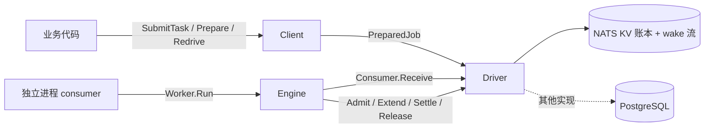
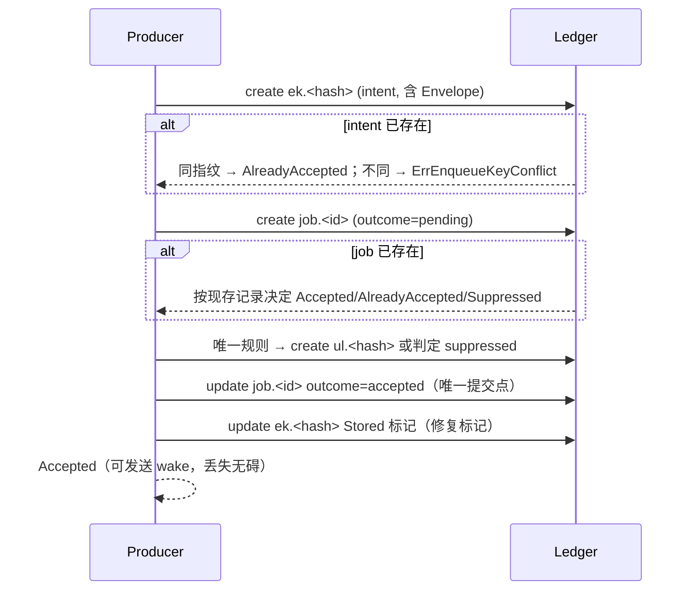
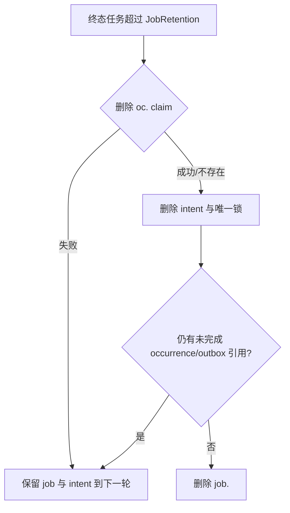

# jetq 设计

本文描述 jetq 最终交付的公共契约、core 与驱动的职责划分、NATS JetStream 驱动的提交/准入/结算/调度协议与安全回收，以及 PostgreSQL 驱动的事务草图。PostgreSQL 部分只做 SQL 与事务伪代码走查，不是实测实现。

## 1. 范围与结构

jetq 是驱动中立的 Go 持久化任务队列：

- `github.com/runforyou-ai/jetq`：公共模型、producer、执行引擎、worker，只依赖 Go 标准库。
- `github.com/runforyou-ai/jetq/natsq`：NATS JetStream 驱动，KV 账本为权威。
- `github.com/runforyou-ai/jetq/drivertest`：驱动符合性套件，任何驱动都以同一组断言验证。
- `github.com/runforyou-ai/jetq/jetqtest`：测试辅助，启动内存 NATS 并 provision 命名空间。

根包不导入任何 NATS 类型；驱动依赖根包，而不是反过来。



## 2. 公共模型

### 2.1 关键签名

```go
// 任务描述符：稳定名称 + 默认策略，不绑定队列、连接或驱动。
func MustTask[T any](name string, defaults Policy) Task[T]
func NewTask[T any](name string, defaults Policy) (Task[T], error)
func Raw(name string) Task[json.RawMessage]

// Producer。
func NewClient(driver Driver, opts ...ClientOption) (*Client, error)
func SubmitTask[T any](ctx context.Context, c *Client, task Task[T], payload T, sub Submission) (EnqueueResult, error)
func PrepareTask[T any](c *Client, task Task[T], payload T, sub Submission) (*PreparedJob, error)
func (c *Client) Submit(ctx context.Context, name string, payload any, sub Submission) (EnqueueResult, error)
func (c *Client) SubmitRaw(ctx context.Context, task Task[json.RawMessage], payload json.RawMessage, sub Submission) (EnqueueResult, error)
func (c *Client) Prepare(name string, payload any, sub Submission) (*PreparedJob, error)
func (c *Client) SubmitPrepared(ctx context.Context, job *PreparedJob) (EnqueueResult, error)

// 管理扩展（由 optional capability 提供）。
func (c *Client) Inspect(ctx context.Context, jobID string) (JobSnapshot, bool, error)
func (c *Client) ListJobs(ctx context.Context, q JobQuery) (JobPage, error)
func (c *Client) Stat(ctx context.Context) (Stats, error)
func (c *Client) PrepareRedrive(ctx context.Context, parentID string, opts ...RedriveOption) (*PreparedJob, error)
func (c *Client) Redrive(ctx context.Context, parentID string, opts ...RedriveOption) (EnqueueResult, error)

// Consumer / worker。
func (c *Client) NewWorker(queues ...Queue) *Worker
func Handle[T any](w *Worker, task Task[T], fn func(ctx context.Context, job T) error, opts ...HandleOption[T])
func HandleTask[T any](w *Worker, name string, fn func(ctx context.Context, job T) error, opts ...HandleOption[T])
func (w *Worker) Run(ctx context.Context) error

// 驱动契约。
type Driver interface {
    Submit(ctx context.Context, job *PreparedJob) (EnqueueResult, error)
    Consumer(ctx context.Context, queue string) (Consumer, error)
}
type Consumer interface {
    Receive(ctx context.Context, max int) ([]Delivery, error)
    Close() error
}
type Delivery interface {
    Envelope() *Envelope
    State() ExecutionState
    Admit(ctx context.Context) (Admission, error)
    Extend(ctx context.Context) error
    Settle(ctx context.Context, dec Decision) (SettleStatus, error)
    Release(ctx context.Context) error
    LeaseDuration() time.Duration
}
```

可选能力接口：`Canceler`（首次准入前取消）、`Inspector`（快照与分页查询）、`Maintainer`（回收与卡住任务恢复）、`BackgroundTasks`（scheduler 生命周期）。未实现的能力不存在于类型上，不以返回 `ErrNotSupported` 的空实现冒充。

### 2.2 身份与载荷

- **JobID** 标识一个逻辑任务，在延迟、重试和 Snooze 期间不变。
- **EnqueueKey** 标识调用方可以重试的提交意图。保留期内同内容返回 `AlreadyAccepted`，内容冲突（指纹不同）返回 `ErrEnqueueKeyConflict`，不覆盖原任务。
- **Fingerprint** 覆盖任务名、队列、载荷、执行时间、执行策略、唯一规则和 ParentJobID；不覆盖生产者时钟等内部生成字段。
- **UniqueRule** 表达业务抑制，与任务身份、提交幂等互不混用。
- **载荷** 是 JSON。原样字节（空白、`<` 等）在编码和持久化后保持不变：`Envelope`/`PreparedJob` 的 JSON 形式把载荷作为不透明字节（JSON 中为 base64）存储；NATS 记录、intent、调度快照同样保持原字节。`WithMaxPayloadBytes` 在进入驱动前限制编码后的字节数。

### 2.3 策略

三层合并，从高到低：提交时的 `Policy`、Task 默认值、生产者默认值。`MaxAttempts`、`Timeout`、`Backoff` 在准备时解析并写入 Envelope；消费者只按 Envelope 执行。零值继承下一层；`NoTimeout()` 显式表示不限制，阻止继承。Backoff 只有可序列化的 Constant 和 Exponential。

### 2.4 提交结果

| 结果 | 含义 |
|---|---|
| `Accepted` | 任务已持久化，可被投递。 |
| `AlreadyAccepted` | 同一 EnqueueKey 已持有相同内容；返回原任务与原始 RunAt。 |
| `Suppressed` | 被唯一规则抑制；不创建可投递任务。 |
| `Unknown` + `ErrUncertain` | 结果无法确定；用同一 EnqueueKey 和同一 prepared 值重试。 |

相对 `Delay` 在准备时固定为绝对 `RunAt`，因此重复 `SubmitPrepared` 不会移动时间；`PrepareRedrive` 让 redrive 的相对延迟同样可幂等重试。没有 JobID 且没有 ID 生成器时返回错误。

## 3. Core 与驱动的职责

**Core（根包）** 唯一实现业务执行政策：

- JSON 解码、输入校验、middleware、handler 调用、panic 恢复。
- 超时（handler ctx 以 `ErrTimeout` 为 cause），超时优先于 handler 返回的 nil/Snooze/Permanent。
- 停机：停止领取与准入，宽限期内完成的正常结算，超过宽限释放；释放使用独立有界 context。
- 未知 handler 的暂缓与超时处置，且不消耗业务预算。
- Decision 生成（succeed/retry/snooze/fail/cancel）、重试分类、失败回调的有界 best-effort 观察。
- 续租：按 `LeaseDuration()/3` 自动 Extend，且覆盖结算 I/O 窗口，直到结算完成才停止。

**驱动** 负责：持久化提交、领取、准入、续租与结算的原子性和恢复协议；租约/token；唯一状态；记录的回收；可查询状态。驱动不复制执行政策。

## 4. 状态与预算

逻辑状态：`awaiting`（含等待原因：首次延迟、重试、Snooze）、`running`、`succeeded`、`failed`、`canceled`。一次业务执行有内部 ExecutionID，状态转移有稳定 transition ID；二者独立于 JobID、业务尝试和物理投递次数。

预算规则（所有驱动一致）：

| 情况 | 预算 |
|---|---|
| 准入完成、即将调用 handler | 消耗一次 |
| 准入后进程崩溃 | 已消耗，不退还 |
| 普通错误、panic、超时 | 不额外消耗 |
| 重试/RetryAfter | 下一次准入再消耗 |
| Snooze 成功结算 | 幂等退还本次，并记入 Snoozes |
| 停机中断后 Release 成功结算 | 幂等退还本次 |
| 未注册 handler、领取后未准入即停机 | 不消耗 |

预算耗尽的投递不再调用 handler，直接失败。领取版本/token 不因退还而回退。

## 5. NATS JetStream 驱动

### 5.1 资源与连接所有权

`Provision(ctx, js, cfg)` 创建/更新命名空间的账本桶（`KV_<namespace>_LEDGER`）、wake 流和调度支持，并在账本 stream 上关闭 `AllowDirect`，保证读取到 leader。`Open(ctx, js, cfg)` 只校验不修改：账本存储模式与副本数必须与配置一致、不得允许 direct 读、wake 流 subject/retention/storage 必须匹配，否则返回明确配置错误。二者接收调用方创建的 `jetstream.JetStream`；`Driver.Close` 停止驱动 goroutine，不关闭连接。

**KV 账本是权威**。wake 流只缩短「新任务可被领取」到「被领取」之间的延迟；wake 丢失由周期账本扫描兜底。因此 wake 不是正确性前提。

### 5.2 账本布局

| Key | 内容 |
|---|---|
| `job.<id>` | 任务记录：Envelope（载荷原字节）、状态、等待原因、预算、Snoozes、投递数、admission、ExecutionID、claim（token、到期时间）、Pending 决定、Applied、Canceled、LastError、唯一状态、终态时间。 |
| `ek.<hash>` | 提交意图：JobID、指纹、Envelope、Stored/Suppressed 标记。 |
| `ul.<hash>` | 唯一预留：JobID、指纹、模式、窗口、Envelope、Stored 标记。 |
| `sc.<hash>` | owner 的调度清单：版本与调度定义（含 Next 游标）。 |
| `oc.<hash>` | 发生（occurrence）claim：owner、调度 key、运行时间、**claim 时固定的完整 PreparedJob**。 |

所有写入使用 revision CAS（create 或 update-if-revision）。

### 5.3 提交



- **create 是唯一提交点**：只有 outcome 为 accepted 且非取消的记录可投递；调用方拿到 `Accepted` 时任务已持久化。
- 同 EnqueueKey 并发：后到者 create 失败后按已存在记录的指纹与意图判断，收敛到同一结果，不覆盖。
- 响应对应丢失（create 已提交但返回超时）：重试发现 intent/job 已存在，返回 `AlreadyAccepted`。
- 指纹不匹配（篡改或内容冲突）：拒绝，不改写。
- 唯一规则按预留键判定：窗口模式在窗口内抑制；UntilDone 直到持有者终态或被明确拒绝。抑制结果写为终态 `suppressed` 记录和意图标记，供保留期内的重放得到同样的 `Suppressed`。
- 崩溃于 intent 与 job 之间、或 Stored 标记之间的情形由 `Recover` 用 intent 中的 Envelope 完成，不更换 JobID 或 RunAt。

### 5.4 领取、准入、续租、结算

- **Receive**：扫描账本 job key，选出该队列、可投递（live 且未取消、RunAt 已到或为空）的记录，用 CAS 写入 claim（token + 到期时间），返回 Delivery。并发消费者只有一个 CAS 成功。部分结果与 error 可同时返回，调用方必须处理已返回投递的归属。
- **Admit**：ExecutionID 在写入前生成并记住；CAS 写 admission 与 budget+1。响应丢失后重试时，若记录中的 ExecutionID 等于本次且 budget 已增加，识别为自己的已提交准入，不重复计费。预算已达上限则拒绝，即使重试也一致。
- **Extend**：只读 released/settled 标志后以 CAS 延长 claim；不与 Settle 共享长锁，因此结算期间续租不被阻塞。
- **Settle**：先持久记录决定（Pending + transition ID），再做清尾工作，最后清除 Pending。同一 transition 重试幂等：已应用返回 `Done`；未记录返回 `NotRecorded` 可重试；清理未完成返回 `RecordedCleanupPending`。Release 与结算对已释放/已结算投递返回 `NotRecorded + ErrClaimLost`，不返回虚假的 `Done`。
- 已记录但未完成清理的决定在下次投递或 `Recover` 时继续完成，**不重新执行业务**。决定写入前崩溃则本次业务可能重跑，这是至少一次边界。
- 决定记录的保留覆盖所有可能存活的副本与后续执行；不以固定倍数 AckWait 推导安全 TTL。

### 5.5 调度

调度是对常规提交路径的周期性提交，不是任务。

- **owner + 版本**：`SyncSchedules(ctx, owner, expected, ...)` 仅在持有版本等于 expected 时更新，否则 `ErrVersionConflict` 且不写；expected 为 0 为 create-only；同定义幂等。滚动发布中旧清单无法删除新清单。
- **游标是运行期状态**：触发只推进 Next，不改变版本。同步时未改变的调度保留原 Next，新增/修改某条调度不会跳过另一条的到期发生。
- **发生 claim**：每个发生以固定 JobID、EnqueueKey、RunAt 和完整 PreparedJob 创建 `oc.` 记录；这是唯一提交点，多个调度器只有一个成功。之后的提交与恢复只使用该快照，与当前清单无关；清单的修改或删除只影响未 claim 的发生。
- **崩溃窗口**：claim 已创建但 job 未写入时，下一次 Fire 或 `Recover` 用快照提交同一 job；同身份不同内容不覆盖，并作为错误返回而非静默吞掉。
- **CatchUp**：false 时跳过停机期间错过的发生，只触发到期的那一次并把游标推进到 now 之后；true 时从最早开始补发最多 `MaxCatchUp` 次。

### 5.6 安全检查与回收

`Recover`（worker 的 `Maintain` 周期调用，或直接调用）处理：

- Pending 决定 → 通过同一路径完成，不重跑 handler。
- 过期的 running claim → 接管，预算保持已消耗。
- 不完整提交 → 用 intent 完成。
- 过期终态任务 → 回收。

**依赖顺序是安全回收的核心**：



- 调度 claim 依赖其 job：只要 claim 存在，job、intent 和幂等决定都必须保留——它们就是「这次发生已经执行过」的事实。claim 删除留到最后无法确认时，job 保留，下一轮再试。
- 被抑制（suppressed）的提交回执同样按此顺序回收。
- claim 删除幂等：不存在即成功；不会产生泄漏，也不会在回收后重放历史发生。
- 回收不依赖某次 `Keys` 遍历顺序，也不依赖固定安全 TTL；依赖关系由 job id 推导的 key 直接定位。

### 5.7 取消

`Cancel` 只作用于首次准入前的任务（awaiting、已排期、snooze 中）：写入取消标记，之后的领取不投递；与到期领取的竞争由 CAS 决定，两种结果都可解释。运行中的任务不中断。驱动不能写入时返回错误，不假装成功。

### 5.8 失败观察

失败回调在持久化失败决定之后执行，是有界 best-effort observer：允许丢失或重复，不承诺业务补偿。需要可靠通知的应用提交独立任务或使用事务 outbox。

## 6. 扫描开销与容量

`Receive` 没有可投递索引：它列出账本中的全部 job key 并逐条读取候选记录，所以领取成本与**保留中**的任务总数相关，而不是可运行任务数。默认 24h 终态保留让已完成任务在保留期内持续影响每次领取。领取可见性由扫描间隔与 wake 流决定，claim lease 决定崩溃 worker 的任务被占用时长。

容量规划：

- 账本条目数与 `JobRetention`、提交速率成正比；调小保留期或按业务分命名空间可降低扫描成本。
- 单个命名空间的写吞吐受 NATS 集群仲裁与 KV 写入限制。
- 设计目标为账本规模在数十万记录以内的工作负载；[docs/benchmarks.md](benchmarks.md) 给出可复现的微基准及适用范围，不是生产压测。

## 7. PostgreSQL 驱动草图（未实现）

以下只做 SQL 与事务走查，避免用 NATS 事务能力推断 PG 行为。事务入队的具体 API 由未来的 PG 包提供，例如 `func (p *Producer) EnqueueTx(ctx context.Context, tx pgx.Tx, job jetq.PreparedJob) (jetq.EnqueueResult, error)`，公共接口不接收 `any` 事务。

```sql
CREATE TABLE jetq_jobs (
  job_id        text PRIMARY KEY,
  queue         text NOT NULL,
  state         text NOT NULL,            -- awaiting|running|succeeded|failed|canceled
  wait          text,                     -- scheduled|retry|snooze
  run_at        timestamptz NOT NULL,
  budget        int NOT NULL DEFAULT 0,
  snoozes       int NOT NULL DEFAULT 0,
  deliveries    int NOT NULL DEFAULT 0,
  admission_id  text,
  claim_token   text,
  claim_until   timestamptz,
  envelope      jsonb NOT NULL,
  enqueue_key   text,
  fingerprint   text,
  unique_kind   text,
  unique_key    text,
  unique_until  timestamptz,
  pending_decision jsonb,
  last_error    text,
  terminal_at   timestamptz,
  updated_at    timestamptz NOT NULL
);
CREATE UNIQUE INDEX jetq_jobs_enqueue ON jetq_jobs (enqueue_key) WHERE enqueue_key IS NOT NULL;
CREATE UNIQUE INDEX jetq_jobs_unique ON jetq_jobs (unique_kind, unique_key)
  WHERE unique_kind = 'until_done';
CREATE INDEX jetq_jobs_ready ON jetq_jobs (queue, run_at)
  WHERE state = 'awaiting';
CREATE INDEX jetq_jobs_gc ON jetq_jobs (terminal_at) WHERE state IN ('succeeded','failed','canceled');
```

**事务入队**：在业务事务内插入 outbox 行；提交后由投递器调用驱动。若要求与业务写入同事务，PG 包提供 `EnqueueTx`，在同一个 `pgx.Tx` 内写 `jetq_jobs` 与 outbox。事务未 commit 时结果不能称为 durable accepted：`EnqueueTx` 只在 commit 成功后返回 `Accepted`，commit 前只能返回「已写入事务、尚未持久」。

**领取**：

```sql
UPDATE jetq_jobs SET claim_token = $1, claim_until = now() + $2, deliveries = deliveries + 1
WHERE job_id IN (
  SELECT job_id FROM jetq_jobs
  WHERE queue = $3 AND state = 'awaiting' AND run_at <= now()
  ORDER BY run_at
  FOR UPDATE SKIP LOCKED
  LIMIT $4
)
RETURNING job_id, envelope, budget, snoozes, deliveries, claim_token;
```

**准入**：

```sql
UPDATE jetq_jobs
SET admission_id = $2, budget = budget + 1, state = 'running', updated_at = now()
WHERE job_id = $1 AND claim_token = $3 AND state = 'awaiting' AND budget < $4
RETURNING budget;
-- 0 行且记录中 admission_id = $2 时，视为本次准入已提交（响应丢失重试）。
```

**结算**（单事务记录决定与退款）：

```sql
BEGIN;
UPDATE jetq_jobs
SET pending_decision = $2, updated_at = now()
WHERE job_id = $1 AND claim_token = $3
  AND (pending_decision IS NULL OR pending_decision->>'transition_id' <> $2->>'transition_id');
-- 已应用则 Done；已记录未应用则继续完成的清尾。
UPDATE jetq_jobs SET state = 'succeeded', terminal_at = now(), pending_decision = NULL
WHERE job_id = $1 AND pending_decision->>'transition_id' = $2->>'transition_id';
-- Snooze：state='awaiting', wait='snooze', run_at=$next, budget=GREATEST(budget-1,0),
--        snoozes=snoozes+1（只退一次）；Release：只退预算，不回来。
COMMIT;
```

- 决定写入与退款、唯一释放、重试排期在同一事务中原子提交，因此不会出现「决定已记但退款丢失」。
- transition ID 幂等。决定写入与业务执行分离：决定事务提交前崩溃会重跑业务（至少一次边界），提交后恢复不重跑。
- 唯一性：`jetq_jobs_enqueue` / `jetq_jobs_unique` 的唯一索引使重复提交与唯一抑制在插入时原子裁决；冲突返回既有任务（同指纹）或 `ErrEnqueueKeyConflict`。
- 唤醒：`pg_notify('jetq_<namespace>', queue)` 只作为唤醒提示，LISTEN 丢失、重连或订阅未建立时由轮询 `jetq_jobs_ready` 兜底；正确性不依赖 NOTIFY。
- 回收：`DELETE ... WHERE state IN (...) AND terminal_at < now() - retention`；与调度 outbox 的完成标记在同一事务里，先确认引用收敛，再删除被依赖的幂等决定。

## 8. 验证

见 [validation.md](validation.md)：每条保证对应的测试组、进程 kill 实验与驱动符合性套件。核心命令：

```sh
go vet ./...
go test -race -count=1 -timeout 180s ./...
golangci-lint run
go list -deps . | grep -i nats   # 根包必须无输出
```
